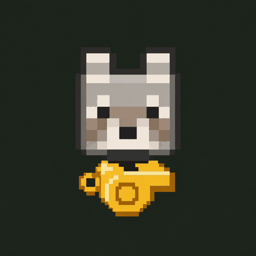

# Pawcall

<p align="center">
  
</p>

<p align="center">
  A Fabric mod for Minecraft Java Edition that brings your nearby tamed pets back to you using normal navigation.
</p>

<p align="center">
  <a href="LICENSE"></a>
  <a href="https://www.curseforge.com/minecraft/mc-mods/pawcall"></a>
  <a href="https://fabricmc.net/use/"></a>
  <a href="https://adoptium.net/"></a>
  <a href="https://github.com/Shahisha1/Pawcall/issues"></a>
</p>

<p align="center">
  <a href="https://www.curseforge.com/minecraft/mc-mods/pawcall">CurseForge</a> ·
  <a href="https://github.com/Shahisha1/Pawcall">Source</a> ·
  <a href="https://github.com/Shahisha1/Pawcall/issues">Issues</a> ·
  <a href="CHANGELOG.md">Changelog</a>
</p>

## Overview

Pawcall gives you a simple way to recall pets you own without teleporting them. Press `G` for a quick 12-block call, or use the Pawcall whistle for a 96-block call. Matching pets pathfind toward you, so terrain, obstacles, unloaded areas, and sitting orders still matter.

## Features

- **Quick call:** Press `G` to call eligible pets within **12 blocks**.
- **Whistle call:** Hold the Pawcall whistle in either hand and press `G`, or right-click the whistle, to call eligible pets within **96 blocks**.
- **Navigation-based recall:** Pets are asked to move toward the player; Pawcall does not teleport entities.
- **Ownership-aware:** Only tamed pets owned by the calling player are considered.
- **Cooldown protection:** Calls share a **1-second (20-tick)** cooldown to prevent rapid repeats.
- **Clear feedback:** Players receive a short status message, and a sound plays when at least one eligible pet is found.

## Compatibility

| Component | Supported / required |
| --- | --- |
| Minecraft Java Edition | 26.3 |
| Fabric Loader | 0.20.1 or newer |
| Fabric API | 0.165.0+26.3 or newer |
| Java | 25 or newer |

Use a Fabric instance that includes both Pawcall and Fabric API. If you update Minecraft, Fabric Loader, or Fabric API, use versions that are compatible with the Pawcall release you installed.

## How It Works

### Call modes

| Mode | Trigger | Range | Whistle required |
| --- | --- | ---: | :---: |
| Quick call | Press `G` | 12 blocks | No |
| Whistle call | Press `G` while holding the whistle in either hand | 96 blocks | Yes |
| Direct whistle use | Right-click the whistle | 96 blocks | Yes |

The default keybind is `G`. You can change it in **Options -> Controls -> Key Binds**.

### Eligible pets

Pawcall searches for `TamableAnimal` entities in the player's current server level that:

- are tamed,
- are owned by the calling player,
- are not ordered to sit, and
- are within the selected range.

Pawcall only considers entities already present in the current dimension and loaded server area. It does not load chunks, search other dimensions, or force pets through unreachable terrain.

### Movement behavior

For each eligible pet, Pawcall asks the pet's navigation system to move toward the player at movement speed **1.25**. If a pet already has navigation in progress, Pawcall leaves that path alone instead of repeatedly resetting it.

Pets may fail to arrive if they are blocked by terrain, hazards, distance constraints, unloaded areas, or pathfinding limits. Sitting pets remain sitting.

## Crafting the Whistle

Craft one Pawcall Whistle in a crafting grid:

<p align="center">
  
</p>

The image above shows the in-game 3×3 crafting layout: place one iron ingot in the top-left slot and one bone directly below it. Leave every other slot empty.

The whistle is also available in the **Tools & Utilities** creative tab.

## Installation

1. Install [Fabric Loader](https://fabricmc.net/use/) for Minecraft **26.3**.
2. Add [Fabric API](https://modrinth.com/mod/fabric-api) or the matching CurseForge release to the same instance.
3. Download Pawcall from [CurseForge](https://www.curseforge.com/minecraft/mc-mods/pawcall) or [GitHub Releases](https://github.com/Shahisha1/Pawcall/releases), or build it from source.
4. Place the Pawcall JAR in your instance's `mods` folder.
5. Launch the Fabric profile.

## Building from Source

Requirements:

- Git
- Java 25 JDK

Clone and build:

```bash
git clone https://github.com/Shahisha1/Pawcall.git
cd Pawcall
```

Windows (PowerShell):

```powershell
.\gradlew.bat build
```

macOS / Linux:

```bash
./gradlew build
```

The distributable JAR is written to `build/libs/`.

To run a development client:

```bash
./gradlew runClient
```

On Windows, use `.\gradlew.bat runClient`.

## Support and Contributing

Bug reports and improvement suggestions are welcome in [GitHub Issues](https://github.com/Shahisha1/Pawcall/issues).

When reporting a problem, please include:

- Pawcall version
- Minecraft Java Edition version
- Fabric Loader version
- Fabric API version
- Java version
- steps to reproduce the issue
- relevant logs or crash reports

Release notes and notable changes are tracked in [CHANGELOG.md](CHANGELOG.md).

## License

Pawcall is available under the [MIT License](LICENSE).
